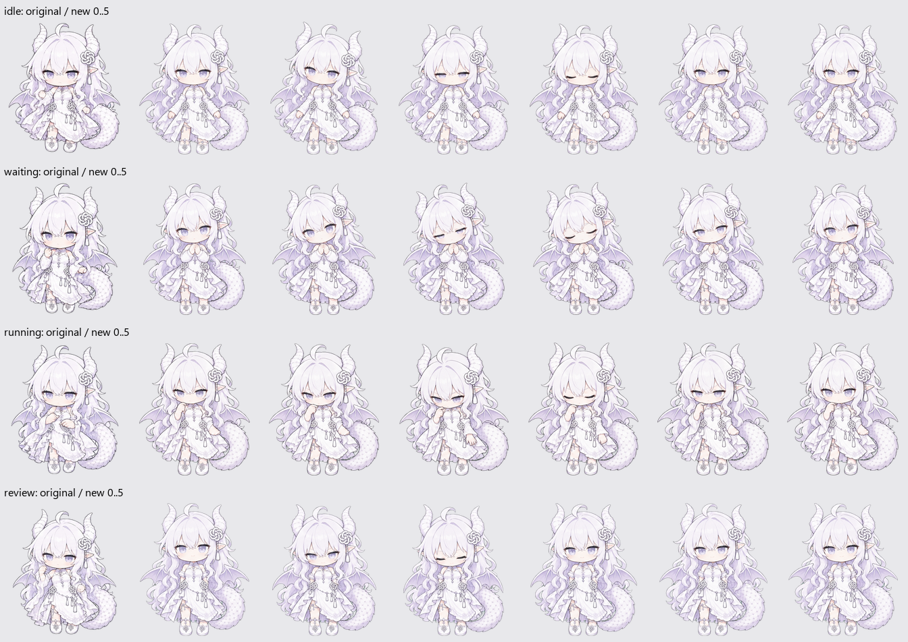

# 霜铃 · Codex 纯宠物

白发紫瞳的小龙娘霜铃。当前最新发布为 **纯宠物安装包**，不包含启动动画或语音，不需要 Python、管理员权限或 API 密钥。

**[下载纯宠物安装包（约 2.7 MB）](https://github.com/beibeiweb/shuangling-codex-pet/releases/download/v2.0.0-pet/shuangling-pet-v2-enhanced.zip)** · [发布说明](https://github.com/beibeiweb/shuangling-codex-pet/releases/tag/v2.0.0-pet)

## 安装与更新

1. 下载上面的 `shuangling-pet-v2-enhanced.zip` 并完整解压。
2. 双击 `Install.cmd`，出现 `Installed pet` 或 `Already up to date` 表示成功。
3. 在 Codex 桌面版刷新宠物列表并重新选择「霜铃」；必要时重启 Codex。

仅支持 Windows；需要支持 sprite v2 自定义宠物的 Codex 桌面版。若下载的是仓库源码 ZIP，根目录 `Install.cmd` 同样只安装宠物，或直接运行 `pet-only/Install.cmd`。

更新会校验包内文件哈希并备份首次安装前的宠物；安装中途失败会恢复原文件。双击 `Uninstall.cmd` 可恢复首次安装前的宠物。额外添加的文件与备份历史保留。已有旧版完整套装管理同名宠物时，应先用旧套装的卸载程序解除管理。

## 动作预览

- 16 个顺时针注视方向，供客户端根据鼠标位置选择。
- 保留抱臂完成姿势，加入四帧眨眼与轻微动作。
- 待机轻摆与眨眼、工作托腮、等待合手、成果待查看时背手微笑。
- 清理透明残留与绿边，各组统一比例和脚底位置；单格仍为 192 × 208，图集为 1536 × 2288。




## 安装位置

- 宠物：`%CODEX_HOME%\pets\shuangling-white-dragon`；未设置时使用 `%USERPROFILE%\.codex`。
- 安装记录：`%LOCALAPPDATA%\ShuanglingCodexPet\PetOnly\pet-installation.json`。
- 备份：同目录的 `backups` 文件夹。

纯宠物安装不修改 Codex 通知配置、原有快捷方式或其他应用设置。状态触发、鼠标跟随和播放时长由 Codex 客户端控制。图集与动画预览已检查，尚未观察所有客户端版本的现场播放。

## 源码与验证

`pet-only/` 是独立的纯宠物分发目录，可完整复制分享。开发验证需要 Python 和 Pillow，安装宠物本身无需 Python。

```powershell
py -3 -m pip install -r requirements-dev.txt
py -3 -m unittest discover -s tests -v
py -3 scripts/pet_atlas.py pet-only/pet --require-new-motion
```

历史完整套装文件保留在仓库中，原有说明见 [旧版文档](docs/legacy-full-suite.md)。最新 Release 的下载 ZIP 仅包含宠物、一键安装/卸载和说明文件。

本项目与 OpenAI 无官方关联。软件源码采用 MIT，图像、角色与其他素材不自动适用源码许可，见 [素材说明](THIRD_PARTY_NOTICES.md)。参考 [奶蛙项目](https://github.com/timerring/codex-pet-naiwa) 的 v2 图集组织与轻量分发方式，未使用其角色图像。
